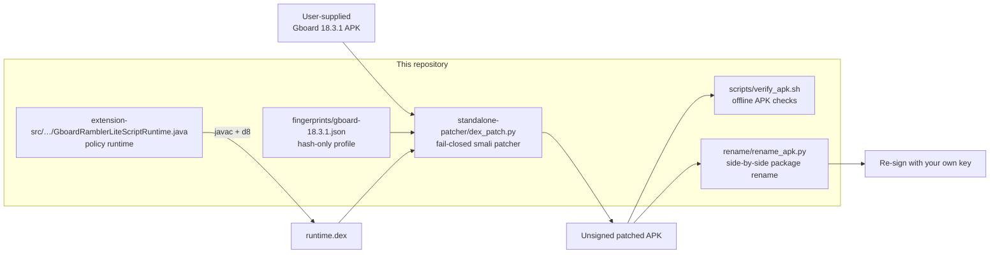
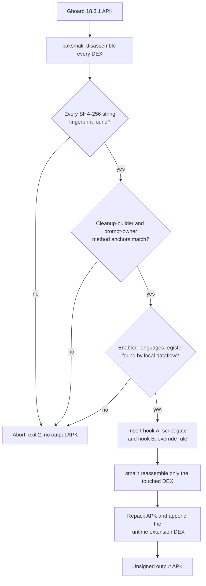

<p align="center"></p>

<p align="center"><b>Dictate in Bangla. Get Bangla.</b> A Bengali-first voice typing patch for Gboard 18.3.1.</p>

<p align="center">
<a href="LICENSE"></a>

<a href="https://github.com/muhib-karim/Rambler-Bangla/actions/workflows/ci.yml"></a>
<a href="https://github.com/muhib-karim/Rambler-Bangla/actions/workflows/tests.yml"></a>


</p>

<p align="center">
<a href="https://muhib-karim.github.io/Rambler-Bangla/"><b>Website</b></a> ·
<a href="docs/V29.3-RELEASE-NOTES.md">Release notes</a> ·
<a href="CHANGELOG.md">Changelog</a> ·
<a href="SECURITY.md">Security</a>
</p>

Rambler Bangla is an open-source patch layer for Gboard 18.3.1. It stops the voice cleanup stage from Romanizing Bengali, and handles mixed Bangla and English one sentence at a time. The repository holds three parts:

- a **fail-closed smali patcher** (Python) that refuses any APK that isn't exactly the profiled build,
- a **policy runtime** (pure Java) that the patched keyboard calls at runtime,
- a **device-free test harness** that builds a synthetic APK, patches it and checks the result.

> **Honest status.** This is a maintainer project with test builds. Host tests and a static CI suite back the claims below. The on-device results listed come from the maintainer's own phone. Anything marked "intended" is design, not proof. There is no public APK (see [Distribution](#distribution)).

The CI suite builds and patches a synthetic APK fixture. It does not install the keyboard on a device or prove real Gboard runtime behavior. UI illustrations on the website use synthetic text. They are mock-ups, not screenshots proving every feature works on a phone.

## Contents

- [Key features](#key-features)
- [Demo](#demo)
- [Quick start](#quick-start)
- [Usage](#usage)
- [Architecture](#architecture)
- [Testing](#testing)
- [Project structure](#project-structure)
- [Status and roadmap](#status-and-roadmap)
- [Distribution](#distribution)
- [Credits and license](#credits-and-license)

## Key features

| Feature | What you get | Evidence |
| --- | --- | --- |
| **Bangla stays Bangla** | Fail-closed patch keeps Bengali dictation in Bengali Unicode for `bn-BD`, `bn-IN` and `bn-Beng`, and English in Latin | 17 end-to-end checks and 51 policy assertions in CI on a synthetic fixture. Bangla-only and English-only layouts confirmed on a real device |
| **Bangla and English together** | One language per sentence on the multilingual layout (abc → বাংলা) | 292-case host corpus. Confirmed on a real device, with a few misses in quick mid-sentence switches |
| **Real Bangla spellings for English words** | কোম্পানি, টেলিভিশন, বার্লিন instead of letter-by-letter output. Built from a CMU-derived table plus reviewed overrides | Blind check: 85 of 200 exact (historical), so expect misses |
| **Protected text** | #hashtags, @handles, links, emails and times stay in Latin letters | Checked in the V29.3 test corpus |
| **Settings you control** | Bangla script correction switch (on by default) and opt-in diagnostics (off by default) | Design intent, see [Settings](#settings) |
| **Clipboard drag-to-reorder** | Long-press an item and drag it | Listed in the V29.3 notes. In development |
| **Own package id** | Installs beside the stock keyboard. Updates signed with the same key install in place | [`docs/SIDE-BY-SIDE.md`](docs/SIDE-BY-SIDE.md) |

Engineering properties of the patcher (all covered by the test suite):

- **Fingerprint-guarded.** The profile stores SHA-256 hashes of strings the target build must contain, never the strings, so no Google text is reproduced here.
- **Dataflow, not offsets.** The enabled-languages register is found by tracing the placeholder to its `String.replace` call, not by trusting a hard-coded register.
- **Fail-closed.** Any fingerprint, anchor or dataflow miss exits with status 2 and writes no output. Re-patching an already patched build is refused too.
- **Never signs.** You re-sign the output with your own key.

### How each layout is designed to behave

Design intent for the V29.3 test build. Not re-verified on a current device.

| Layout | Voice and typing result |
| --- | --- |
| English (US) | English only. Rambler changes nothing. |
| বাংলা (native) | Bangla only. Romanized Bangla and English words become Bangla script. |
| abc → বাংলা | Multilingual. Each sentence is Bangla script or English, decided per sentence. |
| Bangla (Latin) | Treated as Bangla: output is Bangla script. |

Gboard's combined "EN · BN" keyboard reports itself as English (US), so it behaves like the English row. For mixed Bangla and English dictation, use the abc → বাংলা layout.

### Settings

Design intent, not re-verified on a current device. Both switches are in the keyboard's settings, in the Rambler section.

**Bangla script correction** (on by default)
- On: Rambler converts Romanized Bangla to Bangla script, applies the loanword spellings, and follows the per-layout rules above.
- Off: Rambler converts nothing, for voice or typing. You get Gboard's own output unchanged, so Bangla speech may appear in Latin letters. Turn it off if you prefer Romanized Bangla, or to check whether an odd result comes from Rambler or from Gboard.

**Rambler diagnostics** (off by default)
- Use it only when reporting a problem. It is a privacy-sensitive feature and has not been re-audited for the current build.
- Turn it on, reproduce the problem, then turn it off. That saves a log to Downloads as `RamblerBangla-diag-<date>-<time>.txt`.
- The log records the active layout and the text before and after each conversion. It stays on your phone unless you share it. Read it before you share it.

## Demo

A real run of both test suites on a dev machine, rendered from the actual terminal output (no phone, no Google binaries):

<p align="center"></p>

## Quick start

Requirements: Linux x86_64 (the pinned aapt2 is the Linux build), a JDK (17+; CI uses Temurin 21), Python 3 (3.11 tested), `curl`, `unzip`, `zip`.

```bash
git clone https://github.com/muhib-karim/Rambler-Bangla.git
cd Rambler-Bangla

# Fast unit tests: stdlib only, no toolchain needed
python3 -m unittest discover -s tests/python -v

# Full static suite: fetch the pinned toolchain into ./tools, then run
python3 -m pip install androguard==4.1.4
bash scripts/bootstrap_tools.sh
source tools/tool-env.sh
bash tests/run_tests.sh                  # expect "TEST SUITE: 17 passed, 0 failed"
```

`scripts/bootstrap_tools.sh` downloads smali/baksmali/dexlib2 2.5.2 and dependencies (Maven Central), r8/d8 8.3.37, aapt2 8.3.0, apksig 8.3.0 and android.jar 4.1.1.4. It checks every file against `tools-src/toolchain.sha256`, builds the small fixture signer from `tools-src/MiniApkSigner.java`, and writes `tools/tool-env.sh`. Nothing is vendored. Set `TOOLS_DIR` to put the toolchain elsewhere.

## Usage

Against a real Gboard 18.3.1 APK that you supply:

```bash
python3 standalone-patcher/dex_patch.py --help

# 1. Check the APK matches the profile (fingerprints, anchors, dataflow)
python3 standalone-patcher/dex_patch.py analyze \
  --apk /path/to/gboard-18.3.1.apk --profile fingerprints/gboard-18.3.1.json

# 2. Patch it (exits 2 and writes nothing if any check fails)
python3 standalone-patcher/dex_patch.py patch \
  --apk /path/to/gboard-18.3.1.apk --out /path/to/out.apk \
  --profile fingerprints/gboard-18.3.1.json --extension-dex <runtime.dex>

# 3. Verify the output offline, alone or against the stock APK
scripts/verify_apk.sh single /path/to/out.apk --profile fingerprints/gboard-18.3.1.json
scripts/verify_apk.sh compare /path/to/stock.apk /path/to/out.apk
```

The patcher never signs. Re-sign the output with your own key afterwards (upstream builds also rename the package and bypass signature checks, see `rename/` and [`docs/SIDE-BY-SIDE.md`](docs/SIDE-BY-SIDE.md)). To build `runtime.dex`, `javac` the extension class, then run `d8 --min-api 24`. `fixtures/build_fixture.sh` shows both steps.

## Architecture



The patcher does not edit bytes by offset. It disassembles the APK, proves it is looking at the exact build the profile describes, and only then inserts two calls into one method:



1. **Fingerprint sweep.** `fingerprints/gboard-18.3.1.json` lists SHA-256 hashes of strings the target build must contain. One miss means an unrecognized build, and the patcher refuses it.
2. **Anchors.** The cleanup-builder method and the method that owns the cleanup prompt must exist with the exact class, name and signature in the profile.
3. **Dataflow.** Inside the cleanup builder, the patcher traces the `{ENABLED_LANGUAGES}` placeholder to its `String.replace` call to find the register holding the enabled-languages value.
4. **Hooks.** Two calls into `GboardRamblerLiteScriptRuntime` are inserted. At runtime, hook B replaces the injected "Hinglish Override" rule and hook A rewrites only the Romanization bullet of the prompt's SCRIPT GATE, based on the enabled languages. The original rule string stays in place as the fail-safe input.
5. **Repack.** Only the touched DEX is reassembled, and the runtime is added as an extra DEX.

Further runtime layers in the maintainer builds: segment-locked multilingual dictation (V28), Bangla spelling normalization with a 2,265-pair roman-to-script table (V29), and a loanword spelling table built from the CMU Pronouncing Dictionary plus reviewed overrides (V29.3, see `data/loanspell/`).

## Testing

| Suite | Command | What it covers |
| --- | --- | --- |
| Python unit tests | `python3 -m unittest discover -s tests/python -v` | 26 tests on the patcher's pure helpers: smali string unescaping, `invoke` parsing, register-slot maths, `.locals` bumping, the dataflow search on the fixture smali, profile validation, `--help` smoke test, and a check that the loanword `OVERRIDE` block in the Java runtime matches `data/loanspell/overrides.tsv` |
| Static suite | `source tools/tool-env.sh && bash tests/run_tests.sh` | 17 checks in five stages, listed below |

Static suite stages:

| Stage | What it asserts |
| --- | --- |
| 1. Policy unit tests | 51 JVM assertions on the runtime: locale classification, which override rule applies, and the SCRIPT GATE rewrite |
| 2. Fixture build | The fixture APK builds end to end with smali, d8, aapt2 and signing |
| 3. End-to-end patch | Anchors and fingerprints resolve. Both hooks are inserted. The enabled-languages value lands in its own register. Hook arguments don't clobber each other. The stock rule string is preserved. `--extension-dex` adds the runtime DEX |
| 4. Fail-closed negatives | A wrong fingerprint, a one-character change to the stock rule, and re-patching an already patched build each exit with status 2 and produce no APK |
| 5. APK validation | The patched, re-signed fixture passes APK Signature Scheme v2 verification, and androguard parses both the stock and patched APKs |

Both suites run in GitHub Actions on every push to `main` and every pull request ([`ci.yml`](.github/workflows/ci.yml)). The original [`tests.yml`](.github/workflows/tests.yml) still runs the static suite on its own. The job fails unless the suite reports zero failures.

The fixture (`fixtures/`) is a self-built synthetic APK with zero Google content that mirrors the real anchors. For a real patched APK, `scripts/verify_apk.sh` checks the output offline. The dated validation record and the evidence behind each anchor are in [`docs/VALIDATION.md`](docs/VALIDATION.md) and [`docs/EVIDENCE.md`](docs/EVIDENCE.md). The V29.3 golden corpus and scorer are in [`tests/v29.3/`](tests/v29.3/README.md). They need the maintainer build's runtime jar, so they are not part of CI.

The workflows `android-smoke.yml`, `clipboard-e2e.yml` and `keyboard-onboarding-probe.yml` are manual (`workflow_dispatch`) emulator checks for a maintainer-supplied APK, pinned by SHA-256. They are not run on pushes.

## Project structure

```
extension-src/        Java policy runtime (pure Java, no Android deps) + V29.x helpers
standalone-patcher/   dex_patch.py: fingerprint/dataflow-anchored smali patcher
fingerprints/         gboard-18.3.1.json fail-closed profile (hashes only)
fixtures/             synthetic APK fixture (smali sources, manifest, build script)
tests/                run_tests.sh static suite, python/ unit tests, Java policy test, v29.3 corpus
scripts/              bootstrap_tools.sh, verify_apk.sh, clip_e2e.py (emulator driver)
rename/               side-by-side package rename tooling
morphe-patch/         Morphe bytecode patch + RuntimeAbi snippet for the upstream tree
data/loanspell/       loanword table, overrides and Java generator
integration/          upstream patch-list entry
tools-src/            MiniApkSigner.java and pinned toolchain checksums
docs/                 design, evidence, validation, licensing docs and the GitHub Pages site
ledger/               per-version build provenance records
```

## Status and roadmap

See [`CHANGELOG.md`](CHANGELOG.md) for the full history.

- **V29.3 (2026-09-24)**, tagged [v29.3](https://github.com/muhib-karim/Rambler-Bangla/releases/tag/v29.3): one language per sentence in multilingual dictation, English loanword spelling in Bangla voice output. Notes: [`docs/V29.3-RELEASE-NOTES.md`](docs/V29.3-RELEASE-NOTES.md). Build record: [`ledger/v29.3-provenance.md`](ledger/v29.3-provenance.md).
- **V29 (2026-09-23):** field iteration. Design: [`docs/V29-DESIGN.md`](docs/V29-DESIGN.md), fixtures: [`docs/V29-FIXTURES.md`](docs/V29-FIXTURES.md).
- **v28d:** last stable baseline (historical). Evidence: [`docs/EVIDENCE.md`](docs/EVIDENCE.md), [`docs/V28-SEGMENT-LOCK.md`](docs/V28-SEGMENT-LOCK.md).

### Maintainer builds, October 2026

Test builds 245 to 253 are private maintainer builds. Each claim carries its evidence level.

| Item | Level |
| --- | --- |
| Updates signed with the same key install over the existing app, no uninstall | Confirmed on the maintainer's phone (build 253 over 251) |
| Gboard AI writing-tools (refinement) icon visible again on build 253 | Confirmed on the maintainer's phone. Cause of the return is not proven. 253 is a compatibility-only change |
| Build 253: compatibility update that retargets three stale internal ids and adds an observer, with no behaviour flags changed | Two independent static reviews passed. No runtime proof |
| Stray "123" labels suppressed on pinned and list items (display only) | Static review only. Unpinned path clean on the phone. The pinned fix is not phone-confirmed |
| Clipboard recents setting (default 5, range 5 to 10) and masking default off | Static review only |
| Multilingual clause segmentation, phonetic typing with an EN/BN toggle, Bangla (Latin) layout | Planned or in progress. Not working yet |

### Limitations

- Supports exactly one target build, Gboard 18.3.1. Any other build is refused by design.
- CI proves the patching pipeline on a synthetic fixture, not runtime behavior inside real Gboard.
- Loanword spelling is approximate (historical blind check: 85 of 200 exact).

## Distribution

This repository is source only. A patched keyboard contains Google's proprietary Gboard code, which is not licensed for redistribution, so no APK is published here. You apply the patch to a Gboard 18.3.1 APK you obtain yourself and sign it with your own key. Do not upload a patched Google APK, a signing key or private diagnostic output here. See [`docs/LICENSING-AUDIT.md`](docs/LICENSING-AUDIT.md).

## Credits and license

Derivative of **PixelBoard** by Akshay Kadam (GPL v3.0). Built with the Morphe patch engine and smali/baksmali (JesusFreke, BSD). V29 normalization data derives from the Avro Keyboard phonetic dictionary (MPL 2.0). Loanword spellings derive from the CMU Pronouncing Dictionary (BSD, see `NOTICE-cmudict.txt`). Full notices: [`ATTRIBUTION.md`](ATTRIBUTION.md).

Licensed under the GNU GPL v3.0 (see [`LICENSE`](LICENSE)). The repository contains no Google binaries, keys, or model files.
