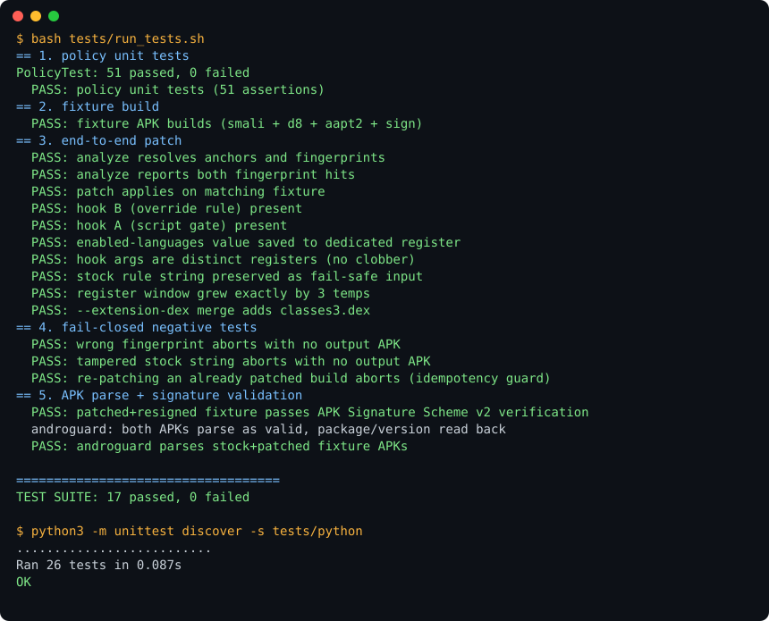
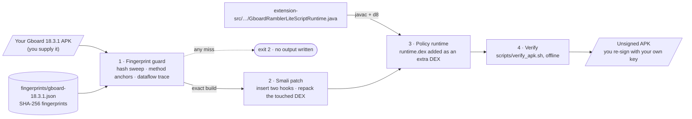

<p align="center"></p>

<h3 align="center">Dictate in Bangla. Get Bangla.</h3>

<p align="center">A fail-closed, fingerprint-guarded patch layer that keeps Gboard 18.3.1 voice typing in Bengali script.</p>

<p align="center">
<a href="https://github.com/muhib-karim/Rambler-Bangla/actions/workflows/ci.yml"></a>
<a href="https://github.com/muhib-karim/Rambler-Bangla/actions/workflows/tests.yml"></a>
<a href="https://github.com/muhib-karim/Rambler-Bangla/releases/latest"></a>
<a href="LICENSE"></a>


</p>

<p align="center">
<a href="#build-from-source"><b>Build from source</b></a> ·
<a href="#how-it-works"><b>How it works</b></a> ·
<a href="#faq"><b>FAQ</b></a> ·
<a href="docs/README.md"><b>Docs</b></a> ·
<a href="https://muhib-karim.github.io/Rambler-Bangla/"><b>Site</b></a>
</p>

## What it is and why

Gboard's on-device voice cleanup stage tends to rewrite Bengali dictation into Latin letters ("ami bhalo achi" instead of "আমি ভালো আছি"), and it mangles sentences that mix Bangla and English. Rambler Bangla is an open-source patch layer for one exact build, Gboard 18.3.1, that fixes this at the source: a **fail-closed smali patcher** (Python) proves it is looking at the profiled build and inserts two hooks, a **pure-Java policy runtime** keeps Bangla in Bengali script and picks one language per sentence, and a **device-free CI suite** builds a synthetic APK, patches it and checks every step, including the refusals, on every push. It is a source-only tool: you patch an APK you obtain yourself and sign it with your own key.

> **Honest status.** This is a maintainer project with private test builds. Host tests and a static CI suite back the engineering claims below. The on-device results come from the maintainer's own phone. Anything marked "design intent" is design, not proof. CI never installs the keyboard on a device, and the website's UI illustrations are mock-ups with synthetic text.

## Contents

- [What it is and why](#what-it-is-and-why)
- [Features](#features)
- [How it works](#how-it-works)
- [Device-free CI](#device-free-ci)
- [Build from source](#build-from-source)
- [Safety: fail-closed by design](#safety-fail-closed-by-design)
- [Layouts and settings](#layouts-and-settings)
- [Source only, no APKs](#source-only-no-apks)
- [FAQ](#faq)
- [Roadmap](#roadmap)
- [Tech stack and project structure](#tech-stack-and-project-structure)
- [Links](#links)
- [Credits and licence](#credits-and-licence)

## Features

| Feature | What you get | Evidence |
| --- | --- | --- |
| **Bangla stays Bangla** | Bengali dictation stays in Bengali Unicode for `bn-BD`, `bn-IN` and `bn-Beng`; English stays in Latin | 17 end-to-end checks and 51 policy assertions in CI on a synthetic fixture. Bangla-only and English-only layouts confirmed on a real device |
| **Bangla and English together** | One language per sentence on the multilingual layout (abc → বাংলা) | 292-case host corpus. Confirmed on a real device, with a few misses in quick mid-sentence switches |
| **Real Bangla spellings for English words** | কোম্পানি, টেলিভিশন, বার্লিন instead of letter-by-letter output, from a CMU-derived table plus reviewed overrides | Blind check: 85 of 200 exact (historical), so expect misses |
| **Protected text** | #hashtags, @handles, links, emails and times stay in Latin letters | Checked in the V29.3 test corpus |
| **Settings you control** | Bangla script correction switch (on by default) and opt-in diagnostics (off by default) | Design intent, see [Settings](#settings) |
| **Own package id** | Installs beside the stock keyboard; updates signed with the same key install in place | [`docs/SIDE-BY-SIDE.md`](docs/SIDE-BY-SIDE.md) |

A real run of both suites on a dev machine, rendered from the terminal output (no phone, no Google binaries). It predates the homepage tests, so it shows the 26 patcher helper tests:

<p align="center"></p>

## How it works



The patcher never edits bytes by offset. It disassembles the APK with baksmali and only patches once every check has passed:

1. **Fingerprint guard.** `fingerprints/gboard-18.3.1.json` lists SHA-256 hashes of strings the target build must contain, plus short identifying fragments such as the rule heading; the full Google prompt text is never reproduced. One miss means an unrecognized build. The cleanup-builder method and the method that owns the cleanup prompt must then exist with the exact class, name and signature in the profile. Finally, the patcher traces the `{ENABLED_LANGUAGES}` placeholder to its `String.replace` call to find the register that holds the enabled languages, rather than trusting a hard-coded register.
2. **Smali patch.** Two calls into `GboardRamblerLiteScriptRuntime` are inserted into the cleanup builder. The original rule string stays in place as the fail-safe input. Only the touched DEX is reassembled.
3. **Policy runtime.** The pure-Java runtime is compiled with `javac`, dexed with d8 and added as an extra DEX. At runtime, hook B replaces the injected "Hinglish Override" rule and hook A rewrites only the Romanization bullet of the prompt's SCRIPT GATE, based on the enabled languages. It is a set of `String` to `String` functions with no Android or network dependencies.
4. **Verify.** `scripts/verify_apk.sh` checks the output offline, on its own or against the stock APK. The patcher never signs: you re-sign the result with your own key (and optionally rename the package with `rename/` so it installs side by side; upstream builds also rename the package and bypass signature checks, see [`docs/SIDE-BY-SIDE.md`](docs/SIDE-BY-SIDE.md)).

Further runtime layers in the maintainer builds: segment-locked multilingual dictation (V28), Bangla spelling normalization with a 2,265-pair roman-to-script table (V29), and a loanword spelling table built from the CMU Pronouncing Dictionary plus reviewed overrides (V29.3, see `data/loanspell/`). The full pipeline, runtime policy and CI design are in [`docs/ARCHITECTURE.md`](docs/ARCHITECTURE.md).

## Device-free CI

No phone, emulator or Google binary is needed to prove the pipeline. [`ci.yml`](.github/workflows/ci.yml) runs on every push to `main` and every pull request, and [`tests.yml`](.github/workflows/tests.yml) runs the static suite on its own. Both fail unless every check passes.

The trick is the fixture: `fixtures/` builds a **synthetic APK with zero Google content** that mirrors the real anchors (class names, method signatures, the cleanup prompt shape). CI builds it from smali sources, patches it with the real patcher, and asserts on the result.

| Suite | What it covers |
| --- | --- |
| **40 Python unit tests** (`tests/python/`, stdlib only) | The patcher's pure helpers: smali string unescaping, `invoke` parsing, register-slot maths, `.locals` bumping, the dataflow search on the fixture smali, profile validation, a `--help` smoke test, the loanword `OVERRIDE` block matching `data/loanspell/overrides.tsv`, and homepage checks that keep this README and the site honest |
| **Static suite**, 17 checks (`tests/run_tests.sh`) | 1. 51 JVM policy assertions (locale classification, override rule, SCRIPT GATE rewrite). 2. The fixture APK builds with smali, d8, aapt2 and signing. 3. End-to-end patch: anchors and fingerprints resolve, both hooks land, the enabled-languages value gets its own register, hook arguments don't clobber each other, the stock rule string is preserved, `--extension-dex` adds the runtime. 4. Fail-closed negatives: a wrong fingerprint, a one-character change to the stock rule and re-patching each exit 2 with no APK. 5. The patched, re-signed fixture passes APK Signature Scheme v2 verification and androguard parses both APKs |

What CI does **not** prove: runtime behaviour inside real Gboard on a phone. That evidence is the maintainer's device testing, recorded with dates in [`docs/VALIDATION.md`](docs/VALIDATION.md) and [`docs/EVIDENCE.md`](docs/EVIDENCE.md). The V29.3 golden corpus in [`tests/v29.3/`](tests/v29.3/README.md) needs the maintainer build's runtime jar, so it is not part of CI. The emulator workflows (`android-smoke.yml`, `clipboard-e2e.yml`, `keyboard-onboarding-probe.yml`) are manual and pinned to a maintainer-supplied APK by SHA-256.

## Build from source

Requirements: Linux x86_64 (the pinned aapt2 is the Linux build), a JDK 17+ (CI uses Temurin 21), Python 3 (3.11 in CI), `curl`, `unzip` and `zip`. The profile targets Gboard version name `18.3.1.977415014 beta`, version code `176004238`, `arm64-v8a`. Any other build is refused.

```bash
git clone https://github.com/muhib-karim/Rambler-Bangla.git
cd Rambler-Bangla

# Fast unit tests: stdlib only, no toolchain needed
python3 -m unittest discover -s tests/python -v

# Fetch the pinned toolchain into ./tools (every file is checked against tools-src/toolchain.sha256)
python3 -m pip install androguard==4.1.4
bash scripts/bootstrap_tools.sh
source tools/tool-env.sh
bash tests/run_tests.sh                  # expect "TEST SUITE: 17 passed, 0 failed"

# Build the policy runtime DEX (same steps as fixtures/build_fixture.sh)
mkdir -p build/ext-classes build/ext-dex
javac -d build/ext-classes \
  extension-src/com/akshaykadam/pixelboard/extension/ramblerlite/GboardRamblerLiteScriptRuntime.java
java -cp tools/r8-8.3.37.jar com.android.tools.r8.D8 --min-api 24 \
  --output build/ext-dex build/ext-classes/com/akshaykadam/pixelboard/extension/ramblerlite/*.class

# 1. Fingerprint guard: check the APK matches the profile
python3 standalone-patcher/dex_patch.py analyze \
  --apk /path/to/gboard-18.3.1.apk --profile fingerprints/gboard-18.3.1.json

# 2-3. Smali patch plus policy runtime (exits 2 and writes nothing if any check fails)
python3 standalone-patcher/dex_patch.py patch \
  --apk /path/to/gboard-18.3.1.apk --out /path/to/out.apk \
  --profile fingerprints/gboard-18.3.1.json --extension-dex build/ext-dex/classes.dex

# 4. Verify the output offline, alone or against the stock APK
scripts/verify_apk.sh single /path/to/out.apk --profile fingerprints/gboard-18.3.1.json
scripts/verify_apk.sh compare /path/to/stock.apk /path/to/out.apk
```

`scripts/bootstrap_tools.sh` downloads smali/baksmali/dexlib2 2.5.2, r8/d8 8.3.37, aapt2 8.3.0, apksig 8.3.0 and android.jar 4.1.1.4 from Maven Central and Google's Maven repository, builds the small fixture signer from `tools-src/MiniApkSigner.java`, and writes `tools/tool-env.sh`. Nothing is vendored; set `TOOLS_DIR` to put the toolchain elsewhere. Signing, installing on your own device, side-by-side renaming and troubleshooting are in [`docs/USER_GUIDE.md`](docs/USER_GUIDE.md).

## Safety: fail-closed by design

The patcher would rather do nothing than guess.

- **Exact build or nothing.** Any fingerprint, anchor or dataflow miss prints `FAIL-CLOSED ABORT: ...`, exits with status 2 and writes no output APK. An uncaught Python error exits 1: if it happens during the final repack (for example a mistyped `--extension-dex` path), delete any partial `--out` file and run again.
- **No double patching.** An APK that already references the runtime is refused, so a patch cannot be applied twice.
- **Hash-based profile.** The fingerprint profile stores SHA-256 hashes plus short identifying fragments, never the full prompt text.
- **Minimal footprint.** Two hook calls in one method plus one extra DEX. The stock rule string is kept as the fail-safe input.
- **Never signs, never uploads.** The patcher and `verify_apk.sh` run offline; you sign with your own key. Only the setup steps touch the network: `bootstrap_tools.sh` checks each download's SHA-256, and `pip` installs the pinned `androguard==4.1.4`.
- **Tested refusals.** CI asserts the refusals too (static suite stage 4), not just the happy path.

### Privacy

- **No network code in the patch layer.** The runtime sources in `extension-src/` use no networking APIs.
- **No new data collection.** Diagnostics are off by default. When turned on, the log is written to the phone's Downloads folder and stays there unless you share it.
- **Sensitive fields pass through.** Password and other sensitive input fields are meant to be left untouched. Any case where conversion runs in one is a security bug (see [`SECURITY.md`](SECURITY.md)).
- **On-device path only.** Bangla is not on Google's list of languages for cloud rewrite, so Rambler only changes the on-device cleanup path. It does not add Bangla to Google's cloud service, and this project does not audit Gboard's own network behaviour.

## Layouts and settings

### How each layout is designed to behave

Design intent for the V29.3 test build (unchanged in V29.4). Not re-verified on a current device.

| Layout | Voice and typing result |
| --- | --- |
| English (US) | English only. Rambler changes nothing. |
| বাংলা (native) | Bangla only. Romanized Bangla and English words become Bangla script. |
| abc → বাংলা | Multilingual. Each sentence is Bangla script or English, decided per sentence. |
| Bangla (Latin) | Treated as Bangla: output is Bangla script. |

Gboard's combined "EN · BN" keyboard reports itself as English (US), so it behaves like the English row. For mixed dictation, use the abc → বাংলা layout.

### Settings

Design intent, not re-verified on a current device. Both switches are in the keyboard's settings, in the Rambler section.

- **Bangla script correction** (on by default). On, Rambler converts Romanized Bangla to Bangla script, applies the loanword spellings and follows the per-layout rules above. Off means Rambler converts nothing, for voice or typing, and you get Gboard's own output unchanged. Useful if you prefer Romanized Bangla, or to tell whether an odd result comes from Rambler or from Gboard.
- **Rambler diagnostics** (off by default). Turn it on only to report a problem, reproduce it, then turn it off: a log is saved to Downloads as `RamblerBangla-diag-<date>-<time>.txt`. It records the active layout and the text before and after each conversion, so read it before you share it. Not yet re-audited for the current build.

## Source only, no APKs

This repository is **source only and publishes no APKs**, now or later. A patched keyboard contains Google's proprietary Gboard code, which is not licensed for redistribution. You apply the patch to a Gboard 18.3.1 APK you obtain yourself, for your own device, and sign it with your own key. Releases such as [v29.4](https://github.com/muhib-karim/Rambler-Bangla/releases/tag/v29.4) are tagged source plus notes.

**Legal note.** Rambler Bangla is an independent project and is **not affiliated with Google**, nor endorsed or sponsored by it. Gboard is a trademark of Google LLC, used here only to name the app the patch targets. The repository contains no Google binaries, keys, model files or full prompt text: the profile holds SHA-256 hashes plus short identifying fragments. Modifying software you use may be restricted by its terms of service or by the law where you live; checking that is your responsibility, and the software comes with no warranty (GPL-3.0, sections 15 and 16). Never upload a patched Google APK, a signing key or private diagnostic output to this repository. The full review is in [`docs/LICENSING-AUDIT.md`](docs/LICENSING-AUDIT.md).

## FAQ

**Can I download a ready-made APK?**
No. See [Source only, no APKs](#source-only-no-apks). Any site offering a "Rambler Bangla APK" is not from this project.

**Why only Gboard 18.3.1?**
The hooks go into obfuscated code whose class and method names change between builds. Pinning one build and proving it with fingerprints is what makes the patch safe. A new Gboard version needs a new, reviewed profile.

**What happens if I feed it a different version?**
It refuses: `FAIL-CLOSED ABORT`, exit status 2, no output. Nothing is half-patched.

**Does CI prove it works on my phone?**
No. CI proves the patching pipeline on a synthetic APK, including the refusals. Phone results come from the maintainer's device and are labelled as such.

**Does it send my voice or text anywhere?**
The patch layer has no network code. It only rewrites the prompt and rule strings inside Gboard's existing on-device cleanup step. Gboard's own behaviour is outside this project's audit.

**Does it translate English into Bangla?**
No. It transliterates: English words spoken inside Bangla get a Bangla spelling (কোম্পানি), they are never translated.

**Why do I need Linux?**
The pinned aapt2 binary used to build the test fixture is the Linux build. The patcher itself is plain Python.

**Can it sit next to the stock keyboard?**
Yes, if you rename the package with `rename/` before signing. See [`docs/SIDE-BY-SIDE.md`](docs/SIDE-BY-SIDE.md).

**Bangla still came out in Latin letters. Is that Rambler?**
Turn off **Bangla script correction** and try again. If the result is the same, it is Gboard's own output. If not, please [open an issue](https://github.com/muhib-karim/Rambler-Bangla/issues/new/choose) with the layout you used.

## Roadmap

### Released

- **V29.4.1 (2026-10-21, docs only, untagged):** this README and the website refresh. No code changes.
- **V29.4 (2026-10-18)**, tag [v29.4](https://github.com/muhib-karim/Rambler-Bangla/releases/tag/v29.4): source release and new maintainer signing key; no conversion changes. Builds signed with the new key cannot install over a V29.3 build: uninstall once first. Notes: [`docs/V29.4-RELEASE-NOTES.md`](docs/V29.4-RELEASE-NOTES.md). Build record: [`ledger/v29.4-provenance.md`](ledger/v29.4-provenance.md).
- **V29.3 (2026-09-24)**, tag [v29.3](https://github.com/muhib-karim/Rambler-Bangla/releases/tag/v29.3): one language per sentence in multilingual dictation, English loanword spelling in Bangla voice output. Notes: [`docs/V29.3-RELEASE-NOTES.md`](docs/V29.3-RELEASE-NOTES.md). Build record: [`ledger/v29.3-provenance.md`](ledger/v29.3-provenance.md).
- **V29 (2026-09-23):** field iteration. Design: [`docs/V29-DESIGN.md`](docs/V29-DESIGN.md), fixtures: [`docs/V29-FIXTURES.md`](docs/V29-FIXTURES.md).
- **v28d:** last stable baseline (historical). Evidence: [`docs/V28-SEGMENT-LOCK.md`](docs/V28-SEGMENT-LOCK.md).

### Maintainer builds, October 2026

Test builds 245 to 253 are private maintainer builds. Each claim carries its evidence level.

| Item | Level |
| --- | --- |
| Updates signed with the same key install over the existing app, no uninstall | Confirmed on the maintainer's phone (build 253 over 251) |
| Gboard AI writing-tools (refinement) icon visible again on build 253 | Confirmed on the maintainer's phone. Cause not proven; 253 is a compatibility-only change |
| Build 253: retargets three stale internal ids and adds an observer, no behaviour flags changed | Two independent static reviews passed. No runtime proof |
| Stray "123" labels suppressed on pinned and list items (display only) | Static review only. Unpinned path clean on the phone; pinned fix not phone-confirmed |
| Clipboard recents setting (default 5, range 5 to 10) and masking default off | Static review only |

### Next

- Multilingual clause segmentation (within a sentence, not just per sentence).
- Phonetic typing with an EN/BN toggle, and a proper Bangla (Latin) layout.
- Clipboard drag-to-reorder, listed in the V29.3 notes and still in development.
- Better loanword accuracy than the historical 85 of 200 exact.

These are planned or in progress and **not working yet**.

### Limitations

- Supports exactly one target build, Gboard 18.3.1. Any other build is refused by design.
- CI proves the patching pipeline on a synthetic fixture, not runtime behaviour inside real Gboard.
- Loanword spelling is approximate.

## Tech stack and project structure

| Area | Tools |
| --- | --- |
| Patcher | Python 3 (standard library only), smali/baksmali 2.5.2 |
| Policy runtime | Pure Java, no Android dependencies, `javac` then d8 (r8 8.3.37, `--min-api 24`) |
| Upstream integration | Kotlin Morphe bytecode patch (`morphe-patch/`) and patch-list entry (`integration/`) |
| APK tooling | aapt2 8.3.0, apksig 8.3.0 (`tools-src/MiniApkSigner.java`), androguard 4.1.4 for parsing |
| Data | Loanword table from the CMU Pronouncing Dictionary (`data/loanspell/`); V29 normalization pairs from the Avro Keyboard phonetic dictionary |
| CI | GitHub Actions on Ubuntu: Python unit tests and the static suite with Temurin 21 and Python 3.11 |

```
extension-src/        Java policy runtime (pure Java, no Android deps) + V29.x helpers
standalone-patcher/   dex_patch.py: fingerprint/dataflow-anchored smali patcher
fingerprints/         gboard-18.3.1.json fail-closed profile (hashes and short fragments)
fixtures/             synthetic APK fixture (smali sources, manifest, build script)
tests/                run_tests.sh static suite, python/ unit tests, Java policy test, v29.3 corpus
scripts/              bootstrap_tools.sh, verify_apk.sh, clip_e2e.py (emulator driver)
rename/               side-by-side package rename tooling
morphe-patch/         Morphe bytecode patch + RuntimeAbi snippet for the upstream tree
patches/              V29.3 smali hook diff for the patch layer's own classes
data/loanspell/       loanword table, overrides and Java generator
integration/          upstream patch-list entry
tools-src/            MiniApkSigner.java and pinned toolchain checksums
docs/                 design, evidence, validation, licensing docs and the GitHub Pages site
ledger/               per-version build provenance records
verification/         dated verification records
```

## Links

| Where | What |
| --- | --- |
| [Website](https://muhib-karim.github.io/Rambler-Bangla/) | The project homepage (GitHub Pages) |
| [`docs/README.md`](docs/README.md) | Index of every design, evidence, validation and licensing document |
| [`docs/USER_GUIDE.md`](docs/USER_GUIDE.md) | Step by step: verify, patch, sign, install, exit codes |
| [`docs/ARCHITECTURE.md`](docs/ARCHITECTURE.md) | Pipeline, policy runtime and CI design |
| [Releases](https://github.com/muhib-karim/Rambler-Bangla/releases) and [`CHANGELOG.md`](CHANGELOG.md) | Tagged source releases and full history; how releases are cut: [`docs/RELEASING.md`](docs/RELEASING.md) |
| [`CONTRIBUTING.md`](CONTRIBUTING.md) | Running the suites before a pull request, and what must never be committed |
| [`SECURITY.md`](SECURITY.md) | Report security problems privately through GitHub's advisory form |
| [`CODE_OF_CONDUCT.md`](CODE_OF_CONDUCT.md) | Contributor Covenant 2.1 |

## Credits and licence

Derivative of **PixelBoard** by Akshay Kadam (GPL v3.0). Built with the Morphe patch engine and smali/baksmali (JesusFreke, BSD). V29 normalization data derives from the Avro Keyboard phonetic dictionary (MPL 2.0). Loanword spellings derive from the CMU Pronouncing Dictionary (BSD, see `NOTICE-cmudict.txt`). Full notices: [`ATTRIBUTION.md`](ATTRIBUTION.md).

Licensed under the GNU GPL v3.0 (see [`LICENSE`](LICENSE)). Not affiliated with Google.
