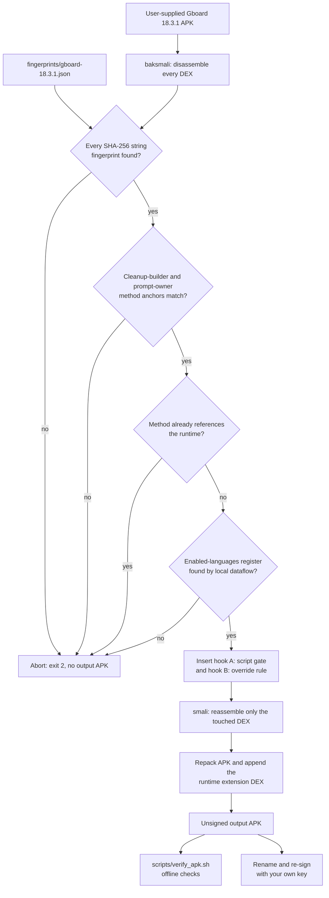
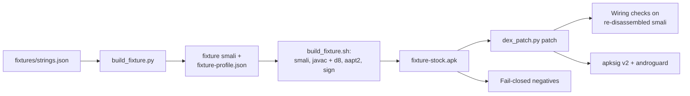

# Architecture

Rambler Bangla has three parts that meet at one method inside Gboard 18.3.1:

1. a **fail-closed smali patcher** (`standalone-patcher/dex_patch.py`) driven by
   a hash-only profile (`fingerprints/gboard-18.3.1.json`),
2. a **policy runtime** in pure Java (`extension-src/`) that the patched
   keyboard calls,
3. a **device-free CI suite** that builds a synthetic APK, patches it and
   checks the result (`fixtures/`, `tests/`).

Supporting tooling covers offline verification (`scripts/verify_apk.sh`),
side-by-side package rename (`rename/`), and integration with the upstream
PixelBoard/Morphe tree (`morphe-patch/`, `integration/`).

## Contents

- [The problem being patched](#the-problem-being-patched)
- [Patcher pipeline](#patcher-pipeline)
- [The profile](#the-profile)
- [Policy runtime](#policy-runtime)
- [Further runtime layers in extension-src](#further-runtime-layers-in-extension-src)
- [CI suite and the synthetic APK](#ci-suite-and-the-synthetic-apk)
- [Upstream integration and rename](#upstream-integration-and-rename)
- [Design rules](#design-rules)

## The problem being patched

Static analysis of the PixelBoard 18.3.1 artifact (recorded in
[`EVIDENCE.md`](EVIDENCE.md) and in the header of the Morphe patch) found two
stock prompt policies in Gboard's on-device voice cleanup stage:

- the cleanup-request builder unconditionally replaces
  `{HINGLISH_OVERRIDE_RULE}` with a 289-byte rule that forces Romanized output
  for any Indian-language and English mix, naming Bengali explicitly;
- the 17,802-byte cleanup prompt contains a SCRIPT GATE whose Branch A mandates
  Indic to ASCII Romanization on a Latin keyboard.

Rambler narrows those two policies based on the enabled-language data that
already flows through the builder method. It adds no transliteration to the
hooks, disables no cleanup stage, and touches nothing outside the anchors.

## Patcher pipeline

Stage by stage, as implemented in `dex_patch.py`:

1. **Disassemble.** Every `classesN.dex` in the APK is disassembled with
   baksmali into a scratch work directory.
2. **Fingerprint sweep.** Every `const-string` in the disassembly is unescaped
   and hashed. Each fingerprint in the profile must be found somewhere in the
   APK, or the patcher refuses an unrecognized build.
3. **Anchors.** The cleanup-builder method must exist with the exact class,
   name and signature in the profile. The prompt-owner method must exist and
   hold the cleanup-prompt fingerprint.
4. **Idempotency guard.** If the builder method already references the
   extension runtime class, the APK was already patched and the run aborts.
5. **Dataflow.** Inside the builder, the patcher finds the `const-string` that
   loads the `{ENABLED_LANGUAGES}` placeholder, follows it to the
   `String.replace(CharSequence, CharSequence)` call that uses that register,
   and takes the replacement argument as the enabled-languages register and the
   following `move-result-object` as the result register. It also checks that
   the stock override rule is loaded *after* the substitution; if control flow
   differs, it aborts rather than guess.
6. **Hook insertion.** The method's register window grows by three temps. One
   is a dedicated save register for the enabled-languages value, captured right
   after `String.replace` so a later `const-string` cannot clobber it. The other
   two form a contiguous pair for `invoke-static/range`. Hook B is inserted
   after the stock rule load and calls `selectHinglishOverrideRule`; hook A is
   inserted after the substitution and calls `rewriteCleanupPromptScriptGate`.
   The stock rule string stays in place as the fail-safe input.
7. **Reassemble and repack.** Only the touched DEX is reassembled with smali.
   Every other entry is copied unchanged, and the runtime DEX passed with
   `--extension-dex` is appended as the next `classesN.dex`.
8. **No signing.** The output is unsigned. The user re-signs it with their own
   key.

Any `PatchError` along the way prints `FAIL-CLOSED ABORT: <reason>` and exits
with status 2 before an output APK is written. The `analyze` command
disassembles the APK, looks up the fingerprints and the method anchors, and
prints what it found as JSON without writing an APK.

## The profile

[`fingerprints/gboard-18.3.1.json`](../fingerprints/gboard-18.3.1.json) is the
single description of the target build:

| Key | Content |
| --- | --- |
| `target` | Package, version name, version code and ABI of the profiled build |
| `methods` | `cleanup_builder` and `prompt_owner`: class, name, signature, DEX, and the evidence for each |
| `fingerprints` | `hinglish_override_rule` and `lite_cleanup_prompt`: SHA-256, byte length and the short published opening fragment |
| `anchors` | The `{ENABLED_LANGUAGES}` and `{HINGLISH_OVERRIDE_RULE}` placeholders |
| `extension_class` | The runtime class the hooks call |
| `known_limits` | Documented limits of the profile |

The profile stores hashes, not the strings, so no Google prompt text is
reproduced in the repository. Supporting a new Gboard build means capturing new
anchors and fingerprints with `analyze` and adding a new profile; see
[`RELEASING.md`](RELEASING.md#fingerprint-updates).

## Policy runtime

[`GboardRamblerLiteScriptRuntime`](../extension-src/com/akshaykadam/pixelboard/extension/ramblerlite/GboardRamblerLiteScriptRuntime.java)
is pure Java with no Android dependencies. Its public surface:

| Method | Role |
| --- | --- |
| `classifyEnabledLanguages(String)` | Splits the enabled-language string into tags and returns `NO_INDIC`, `EXPLICIT_LATIN_ONLY` (every Indic tag has a `-Latn` subtag), `NATIVE_PRESENT` (at least one native-script Indic tag such as `bn-BD`, `bn-IN`, `bn-Beng`) or `UNKNOWN` (no data) |
| `selectHinglishOverrideRule(stockRule, langs)` | Hook B. Native Indic: a native-script preservation rule. Explicit Latin: the stock rule. No Indic: an empty rule. Unknown: the stock rule |
| `rewriteCleanupPromptScriptGate(prompt, langs)` | Hook A. Only under `NATIVE_PRESENT`, and only when the stock Branch A block is found verbatim, rewrites that one Romanization bullet into an enabled-language-driven script rule. Everything else in the prompt stays byte-identical |
| `admitExactBengaliLocales(Set)` | Hypothesis-stage hook for the off-by-default locale-admission experiment: admits exact `bn-BD` / `bn-IN` into a dictation supported-locale set. Not part of the proven cleanup boundary; see [`VALIDATION.md`](VALIDATION.md) |

Fail-safe contract: any null, blank or unknown input returns the stock input
unchanged. `lastHookStatus` records the outcome of the last hook call for
device-side validation, and `HOOK_VERSION` identifies the hook ABI.

The policy is covered by
[`GboardRamblerLiteScriptRuntimeTest`](../tests/src/com/akshaykadam/pixelboard/extension/ramblerlite/GboardRamblerLiteScriptRuntimeTest.java)
(51 assertions), stage 1 of the static suite.

## Further runtime layers in extension-src

The maintainer builds carry more runtime code on top of the hook runtime. The
V29.x helpers in `extension-src/com/akshaykadam/pixelboard/extension/rambler/`
are:

- **`GboardRamblerSentenceLang`** (V29.3): on the multilingual layout in AUTO
  mode, decides language per sentence. A Bangla sentence converts every word;
  an English sentence stays byte-identical. Protected spans (URL, email,
  handle, hashtag, time) never vote and are copied byte-for-byte. Any failure
  returns null and the caller falls back to the V29 segment vote.
- **`GboardRamblerLoanSpell`** (V29.3): voice-only spelling for English words
  inside Bangla output. Order: curated overrides, then the pronunciation table,
  then the older letter converter. Bangla words always return null. The table
  loads once on a background thread. The data and generator are in
  [`data/loanspell/`](../data/loanspell/README.md).

Hooks for these helpers in the patch layer's own classes are recorded in
[`patches/v29.3-smali-hooks.diff`](../patches/v29.3-smali-hooks.diff). Design
background: [`V28-SEGMENT-LOCK.md`](V28-SEGMENT-LOCK.md),
[`V29-DESIGN.md`](V29-DESIGN.md) and
[`V29.3-RELEASE-NOTES.md`](V29.3-RELEASE-NOTES.md). The V29.3 golden corpus and
scorer are in [`tests/v29.3/`](../tests/v29.3/README.md); they need the
maintainer build's runtime jar and are not part of CI.

## CI suite and the synthetic APK

The fixture in [`fixtures/`](../fixtures/) is a self-built APK with zero Google
content. Its smali classes reuse the obfuscated class names and method shape of
the real anchors, and `build_fixture.py` generates the fixture smali and a
matching `fixture-profile.json` from `strings.json`, so the strings and their
hashes have one source. `build_fixture.sh` assembles `classes.dex` with smali,
compiles the runtime with `javac` and d8 into `classes2.dex`, links the manifest
with aapt2 and signs with a locally generated, fixture-only key.

[`tests/run_tests.sh`](../tests/run_tests.sh) runs 17 checks in five stages:

| Stage | What it asserts |
| --- | --- |
| 1. Policy unit tests | 51 JVM assertions on the runtime |
| 2. Fixture build | The fixture APK builds end to end |
| 3. End-to-end patch | Anchors and fingerprints resolve; both hooks present; enabled-languages value saved to its own register; hook arguments do not clobber each other; stock rule preserved; register window grew by exactly three; `--extension-dex` adds the runtime DEX |
| 4. Fail-closed negatives | Wrong fingerprint, a one-character change to the stock rule, and re-patching each exit 2 with no APK |
| 5. APK validation | Patched and re-signed fixture passes APK Signature Scheme v2 verification; androguard parses stock and patched APKs |

[`tests/python/test_dex_patch.py`](../tests/python/test_dex_patch.py) adds 26
standard-library unit tests for the patcher's helpers and checks that the
loanword override block in the Java runtime matches
`data/loanspell/overrides.tsv`.

GitHub Actions runs both suites on every push to `main` and every pull request
([`ci.yml`](../.github/workflows/ci.yml)); [`tests.yml`](../.github/workflows/tests.yml)
runs the static suite on its own. The toolchain is fetched by
`scripts/bootstrap_tools.sh` and pinned by SHA-256 in
`tools-src/toolchain.sha256`. Three further workflows (`android-smoke.yml`,
`clipboard-e2e.yml`, `keyboard-onboarding-probe.yml`) are manual emulator checks
for a maintainer-supplied APK pinned by SHA-256; they do not run on pushes.

What CI proves: the patching pipeline, its fail-closed behavior and the runtime
policy. What it does not prove: runtime behavior inside real Gboard on a device.

## Upstream integration and rename

- [`morphe-patch/`](../morphe-patch/) holds the same patch expressed as a Morphe
  bytecode patch for the PixelBoard tree, plus the two `RuntimeCallId` entries
  to merge into its runtime ABI. `dex_patch.py` is the reproducible local route
  used while the Morphe Gradle plugin cannot resolve.
- [`integration/patches-list-entry.json`](../integration/patches-list-entry.json)
  is the upstream patch-list entry, including the off-by-default
  locale-admission experiment.
- [`rename/`](../rename/) rewrites the package identity (manifest, resource
  XMLs, `resources.arsc`, DEX string literals) so a build installs next to the
  stock keyboard. See [`SIDE-BY-SIDE.md`](SIDE-BY-SIDE.md).

## Design rules

- **Fail closed.** A mismatch aborts; the patcher never guesses.
- **One target.** The profile describes exactly one build.
- **No Google content.** Hashes and short published fragments only; no APKs,
  DEX or smali dumps of Google classes, models or keys.
- **Never sign.** Signing keys belong to whoever builds, never to the
  repository.
- **Stock on doubt.** At runtime, unknown input returns the stock value.
